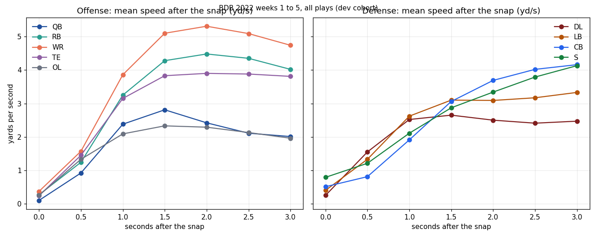

# NFL role movement reference: BDB 2022, weeks 1 to 5

Status: descriptive reference, dev cohort only. Weeks 6 to 9 are reserved as the holdout and were not used.
Generated from `role_reference.json` by the scratch scripts `role_extract.py` and `role_aggregate.py`.

## What it covers

- 9,333 live plays and 205,326 player-plays (22 per play), 2022 weeks 1 to 5.
- Kneels and spikes (123 plays) are left out: the participation data has no formation label for them, and they do not move.
- Speeds and accelerations are the BDB fields, in yards per second and yards per second squared. 1 yd/s is about 2.05 mph.
- Depth is yards from the ball spot along the play direction. Negative is behind the line for the offense.
- Peak speed is taken over the first 5 s after the snap. Distance and displacement use the first 3 s.

## How the sources combine

| Source | Key | What it adds | Match |
| --- | --- | --- | --- |
| BDB 2025 tracking (`tracking_week_1..5.csv`, 10 Hz) | gameId, playId, nflId | 22 players per play: x, y, speed, acceleration at the snap and after | 9,456 plays in the dev weeks |
| BDB `plays.csv` | gameId, playId | Possession team, so each player is offense or defense | all tracked plays |
| BDB `players.csv` | nflId | Position, grouped into QB, RB, WR, TE, OL, DL, LB, CB, S | every tracked player |
| nflverse participation 2022 (`pbp_participation_2022.csv`) | old_game_id = gameId, play_id = playId | Offense formation (SHOTGUN, SINGLEBACK, EMPTY, I_FORM, PISTOL, JUMBO, WILDCAT), defense man or zone, coverage | 16,124 of 16,124 BDB plays in 2022 |
| FTN charting 2022 (`ftn_charting_2022.csv`) | nflverse_game_id, nflverse_play_id (from participation) | Motion and play action flags for each offense row | every offense row in the dev weeks |

Check on the formation labels: the tracked quarterback depth agrees with the labels. Shotgun, pistol and empty sets put the quarterback about 4.6 yd deep, and under-center and singleback sets put him about 1.4 yd deep. The labels are consistent with the tracking.

## By role: all live plays

| Side | Role | Player-plays | Depth at snap (yd) | Peak speed, median (yd/s) | Peak speed, 10th to 90th (yd/s) | Time to peak (s) | Peak accel, 90th (yd/s²) | Displacement 1 s (yd) | Displacement 3 s (yd) | Distance 3 s (yd) | Lateral share, 3 s |
| --- | --- | ---: | ---: | ---: | --- | ---: | ---: | ---: | ---: | ---: | ---: |
| offense | QB | 9,370 | -4.12 | 3.61 | 1.8 to 5.6 | 1.60 | 5.75 | -0.93 | -3.63 | 5.28 | 0.28 |
| offense | RB | 10,490 | -5.04 | 5.56 | 3.7 to 7.4 | 2.30 | 6.10 | 0.57 | 5.26 | 9.74 | 0.54 |
| offense | WR | 23,886 | -0.90 | 6.38 | 4.0 to 8.3 | 2.20 | 6.08 | 1.36 | 8.50 | 12.11 | 0.36 |
| offense | TE | 11,987 | -1.12 | 5.15 | 2.9 to 7.3 | 2.40 | 5.96 | 0.74 | 3.99 | 8.81 | 0.53 |
| offense | OL | 46,928 | -0.81 | 3.08 | 2.0 to 4.5 | 2.20 | 3.56 | -0.39 | -2.25 | 5.65 | 0.44 |
| defense | DL | 29,078 | 0.95 | 3.89 | 2.4 to 5.6 | 2.80 | 4.26 | -1.17 | -3.27 | 6.66 | 0.44 |
| defense | LB | 28,409 | 3.53 | 4.96 | 3.1 to 6.9 | 3.00 | 5.65 | -0.69 | -1.20 | 7.44 | 0.52 |
| defense | CB | 24,538 | 4.89 | 5.31 | 3.3 to 7.6 | 3.10 | 5.71 | 0.39 | 4.13 | 7.79 | 0.45 |
| defense | S | 20,572 | 11.07 | 5.46 | 3.6 to 7.4 | 3.30 | 5.57 | 0.29 | 1.44 | 7.77 | 0.47 |

Two rows are one-player artifacts (an offense DL and an offense LB, n = 1 each). They are not used here.

## By offense formation

Only formation groups with at least 100 player-plays are shown.

| Role | Formation | Player-plays | Depth (yd) | Peak speed, median (yd/s) | Time to peak (s) | Displacement 3 s (yd) |
| --- | --- | ---: | ---: | ---: | ---: | ---: |
| OL | EMPTY | 4,036 | -0.84 | 3.12 | 2.20 | -4.57 |
| OL | I_FORM | 3,228 | -0.85 | 3.13 | 2.30 | 0.71 |
| OL | JUMBO | 421 | -0.59 | 2.37 | 1.90 | 0.90 |
| OL | PISTOL | 1,691 | -0.65 | 3.21 | 2.30 | 0.35 |
| OL | SHOTGUN | 25,252 | -0.79 | 3.03 | 2.20 | -3.58 |
| OL | SINGLEBACK | 12,184 | -0.86 | 3.23 | 2.20 | 0.59 |
| OL | WILDCAT | 116 | -0.58 | 2.98 | 2.20 | 1.79 |
| QB | EMPTY | 815 | -4.59 | 2.75 | 1.50 | -2.94 |
| QB | I_FORM | 630 | -1.37 | 4.42 | 1.50 | -7.11 |
| QB | PISTOL | 338 | -4.62 | 3.56 | 2.40 | -1.92 |
| QB | SHOTGUN | 5,058 | -4.57 | 2.89 | 1.90 | -2.65 |
| QB | SINGLEBACK | 2,430 | -1.37 | 4.51 | 1.50 | -7.41 |
| RB | EMPTY | 826 | -1.68 | 6.06 | 2.50 | 5.54 |
| RB | I_FORM | 1,083 | -6.64 | 5.52 | 2.00 | 5.92 |
| RB | JUMBO | 105 | -6.26 | 5.22 | 1.60 | 5.69 |
| RB | PISTOL | 468 | -6.60 | 5.55 | 2.10 | 5.21 |
| RB | SHOTGUN | 5,344 | -4.77 | 5.45 | 2.40 | 4.38 |
| RB | SINGLEBACK | 2,623 | -7.19 | 5.66 | 2.10 | 6.79 |
| TE | EMPTY | 963 | -0.88 | 6.12 | 2.60 | 6.92 |
| TE | I_FORM | 858 | -1.22 | 4.46 | 2.40 | 2.72 |
| TE | JUMBO | 168 | -1.00 | 3.23 | 1.90 | 2.21 |
| TE | PISTOL | 502 | -1.10 | 4.86 | 2.30 | 3.90 |
| TE | SHOTGUN | 5,756 | -1.01 | 5.72 | 2.40 | 5.69 |
| TE | SINGLEBACK | 3,710 | -1.32 | 4.35 | 2.50 | 2.16 |
| WR | EMPTY | 2,237 | -0.88 | 6.77 | 2.40 | 10.24 |
| WR | I_FORM | 1,130 | -0.90 | 5.78 | 2.15 | 7.69 |
| WR | PISTOL | 719 | -0.81 | 6.00 | 2.10 | 7.89 |
| WR | SHOTGUN | 14,118 | -0.88 | 6.53 | 2.30 | 9.17 |
| WR | SINGLEBACK | 5,574 | -0.97 | 5.89 | 2.10 | 7.24 |

## By defense coverage

Coverage is the nflverse man or zone label for the play. Defenders on plays without a label are left out of this table only.

| Role | Coverage | Player-plays | Depth at snap (yd) | Displacement 3 s (yd) | Peak speed, median (yd/s) |
| --- | --- | ---: | ---: | ---: | ---: |
| CB | Man Coverage | 4,451 | 2.74 | 5.73 | 6.41 |
| CB | Zone Coverage | 9,614 | 5.80 | 5.45 | 5.54 |
| DL | Man Coverage | 4,809 | 0.98 | -5.53 | 4.00 |
| DL | Zone Coverage | 10,768 | 0.96 | -5.19 | 4.13 |
| LB | Man Coverage | 4,641 | 2.14 | -3.87 | 5.22 |
| LB | Zone Coverage | 10,841 | 3.82 | 0.39 | 5.35 |
| S | Man Coverage | 3,634 | 8.59 | 2.53 | 5.96 |
| S | Zone Coverage | 7,935 | 12.10 | 4.54 | 5.68 |

## Speed after the snap

Mean speed (yd/s) at each half second after the snap. The chart is `nfl-role-speed-curves-2022-weeks1-5.png` in this folder.

| Role | 0.0 s | 0.5 s | 1.0 s | 1.5 s | 2.0 s | 2.5 s | 3.0 s |
| --- | ---: | ---: | ---: | ---: | ---: | ---: | ---: |
| off QB | 0.10 | 0.92 | 2.38 | 2.81 | 2.42 | 2.11 | 2.01 |
| off RB | 0.27 | 1.24 | 3.25 | 4.28 | 4.48 | 4.35 | 4.02 |
| off WR | 0.37 | 1.57 | 3.86 | 5.10 | 5.31 | 5.09 | 4.74 |
| off TE | 0.24 | 1.45 | 3.15 | 3.83 | 3.90 | 3.88 | 3.81 |
| off OL | 0.25 | 1.33 | 2.09 | 2.33 | 2.29 | 2.13 | 1.96 |
| def DL | 0.25 | 1.55 | 2.52 | 2.65 | 2.50 | 2.41 | 2.47 |
| def LB | 0.40 | 1.33 | 2.62 | 3.10 | 3.09 | 3.17 | 3.33 |
| def CB | 0.51 | 0.81 | 1.91 | 3.06 | 3.69 | 4.02 | 4.16 |
| def S | 0.79 | 1.21 | 2.11 | 2.87 | 3.34 | 3.79 | 4.13 |

## Caveats

- Dev cohort only, 2022 weeks 1 to 5. Weeks 6 to 9 are not in these numbers.
- Descriptive medians, not a model. Each number describes the cohort, and no player-level ratings are involved.
- Route type, the receiver in each route, and the FTN flags beyond motion and play action are in the nflverse and FTN files but are not split out here yet.
- Rows: `role-movement-weeks1-5.csv` in `/root/nfl-tracking-data/bdb2025/audit/` holds the player-play table behind this reference. It is derived from third-party tracking and is not committed.
