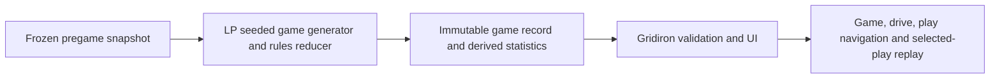

# Statistical full-game simulation: implementation status

Date: 2026-10-25  
Goal: generate a complete hypothetical NFL game from a frozen pregame snapshot in Legendary Picks (LP), then display and replay the immutable result in Gridiron Physics.

## Status at a glance

The end-to-end pieces exist as research implementations, but the pregame full-game path is not complete.

| Area | Current state | Remaining |
| --- | --- | --- |
| LP game generation | E2 emits a regulation sequence with drives, plays, score and statistics. The successor branch fixes several state and source-semantic defects. | The source is retrospective, lacks a frozen upcoming-game snapshot and current-game roster, and does not yet resolve all NFL transitions. |
| Full-game validity | The E2 successor's limited-rule checker accepted 300/300 records. Of those, 288 reached regulation end only in a guarded state and 12 were blocked. There were zero complete games and zero `valid_full_game=true` records. | Implement or explicitly resolve all transitions required for a normal complete game, including overtime and clock, penalty and rare-event handling. |
| Gridiron viewer | The E2 viewer can verify a pinned record and navigate game → drive → play. The accepted sample has 24 drives and 143 plays. | Repin it to the final prospective LP output and add selected-play replay with eligible team rosters and participant identities. |
| Statistical realism | Historical PBP is available as a training/evaluation source. | Freeze forecast-time inputs and report held-out game and player-stat distributions separately from state legality. |

The E2 successor evidence is a regulation-only research milestone, not a full legal game or a pregame forecast. Its 300-seed results and remaining guards are in the [LP E2 successor gate request](https://github.com/micahp/legendarypicks/blob/feat/nfl-sequence-e2-successor-2026-10-24/docs/evidence/e2-successor/GATE-REVIEW-REQUEST-E2-SUCCESSOR.md). The accepted Gridiron fixture is retrospective and has `valid_full_game=false`; see the [Gridiron E2 integration proof](GRIDIRON-E2-INTEGRATION-PROOF-A442DCD7-2026-10-24.md).

## Intended data flow

LP owns pregame data eligibility, event sampling, player selection, state transitions and the authoritative play log. Gridiron validates and displays that record without changing its outcomes. A play animation may be illustrative; it must not replace the LP result or imply that the physical solver produced the statistical outcome.

## Work required

### 1. Freeze prospective inputs in LP

For each scheduled matchup, create a content-addressed snapshot containing:

- stable game ID, home/away teams and scheduled kickoff;
- forecast `as_of` time, rules version and source-data cutoffs;
- eligible roster, projected starters, availability/inactives and player role shares as known at that time;
- model version, snapshot hash, roster snapshot ID and seed derivation.

Audit every feature for temporal eligibility. Historical play outcomes may train distributions, but the generator must not use the target game's future results, postgame participants or realized statistics. The LP [pregame play-sequence spec](https://github.com/micahp/legendarypicks/blob/dev/docs/SPEC-nfl-pregame-play-sequence-generator-v1.md) is the target contract; its status still says the prospective generator is proposed.

### 2. Complete the LP game engine

Build on the existing E2 generator and authoritative reducer. Sample each action and result from the current game state; never force a separately predicted final score. Derive team and player box scores from the generated plays so totals cannot disagree with the event log.

The E2 successor has already repaired or tested several items, including publisher-specific try results, normal-mode toss sampling, game-wide play IDs and drive indexes. Before promotion, close the remaining full-game gates and reconcile them with the latest versioned NFL rules:

- resolve clock running/stopped state, timeout stops/restarts, two-minute warnings and penalties;
- continue a regulation tie through overtime instead of returning an overtime guard;
- handle missed-field-goal touch/return exceptions, rare kick cells, safety free kicks and other sampled special-teams outcomes;
- preserve exactly two normal-mode half-opening kickoffs by opposite teams, with Q1/Q3 end changes and halftime transitions applied correctly;
- ensure scoring, tries, post-score restarts, possession, downs, field position and all drive endings use the same reducer.

An unsupported sampled event must fail visibly and keep the record incomplete. It must never be silently skipped or labeled a complete game. Update the model and rules pins against the current LP rules source before regenerating evidence.

### 3. Publish a complete immutable game record

Emit the shared full-game record with real game/team IDs, snapshot and roster references, model/rules versions, ordered game-wide play IDs, explicit play durations, participants, before/after states, event outcomes, and team/player statistics. Include source hashes and provenance. Set `valid_full_game=true` only after all producer checks pass.

The first deliverable can be an offline CLI that writes versioned JSON. An HTTP API is optional for the first vertical slice. The same model version, snapshot and seed must reproduce byte-identical output; different seeds must produce meaningfully different sequences.

### 4. Finish the Gridiron UI path

Keep the current read-only E2 viewer behavior: verify the pinned source, retain the LP record unchanged, and navigate game → drive → play. Repin its manifest and fixtures to the final LP producer commit rather than the retrospective a442 baseline.

For selected-play replay, provide the eligible roster and player identities needed to construct the scene. Display the LP score, clock, field position, event, participants and stats alongside the replay. Keep statistical outcome provenance clear, and ensure the rendered play cannot alter the record. The current E2 viewer is an event/field-state timeline; it does not yet replay this game's roster, routes or motion. See the [payload contract](../GRIDIRON-E2-GAME-PAYLOAD-v1.md).

## Acceptance gates

1. **Pregame integrity:** every input is sourced, hashed and available by the declared `as_of`; no target-game future outcomes or participants enter generation.
2. **Rules and state:** every emitted play has valid before/after state; scores, possession, down/distance, clock, field position, drive endings and kickoffs reconcile. No guarded or blocked game is reported as complete.
3. **Statistics:** team totals and player passing, rushing, receiving and supported special-teams statistics recompute from the immutable play log and match the published summary.
4. **Reproducibility:** same snapshot/model/rules/seed produces identical bytes; other seeds vary; a deterministic batch records runtime and failures.
5. **UI integration:** at least two upcoming matchups with distinct snapshots pass the Gridiron adapter, load in the browser, navigate all drives and plays, and replay selected plays while preserving source IDs and outcomes.
6. **Realism evaluation:** compare play, drive, scoring, clock, possession and player-stat distributions against held-out historical regimes. Keep this separate from legal-state validation; forecast accuracy is a later evaluation gate for this entertainment simulation.

## Smallest delivery sequence

1. Commit a clean, reproducible LP source snapshot and generate one complete game from a frozen pregame input using a CLI.
2. Run LP rule/state/stat reconciliation and verify byte-identical regeneration from the same seed.
3. Pin that exact record and its hashes in Gridiron; load and navigate it in the existing game viewer.
4. Add selected-play roster-backed replay without changing any LP result.
5. Generate a second matchup from a different snapshot, then run multi-seed and held-out distribution checks.

The existing physical movement and contact projects are not prerequisites for the statistical game generator. They can support later replay improvements without owning the result.
